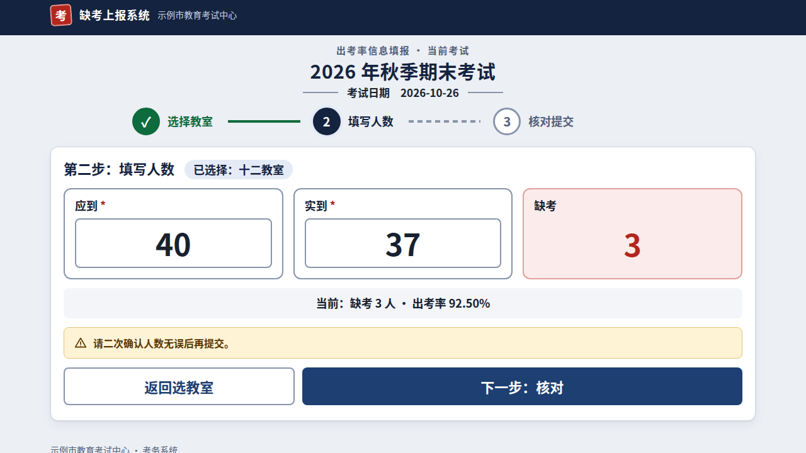
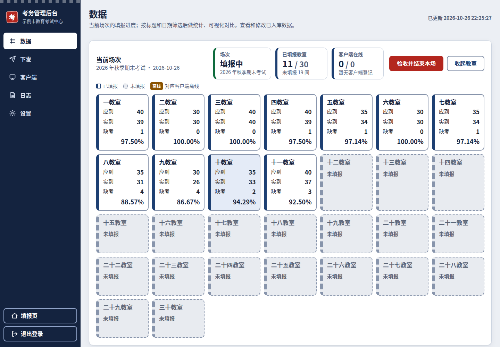
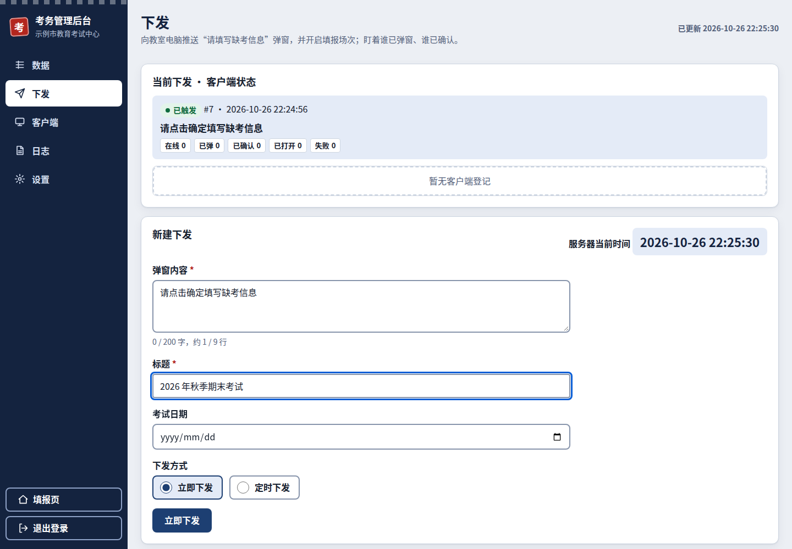

# 缺考上报系统（Qeukao）

考试现场用的 **缺考 / 出考率上报系统**：考务管理员在后台「下发」一场考试，每间教室的电脑自动弹窗，监考老师点「确定」后打开填报页，填写应到、实到人数，系统自动算出缺考人数和出考率；管理员在后台实时看各教室填报进度，验收后导出统计表。

- **开箱即用**：服务端是一个 Windows exe，双击就能运行，不用装数据库，也不用装 Python。
- **任何单位都能用**：单位名称、教室数量和名称、填报提醒都在后台「设置 → 基本信息」里填写，代码里不带任何单位的信息。
- **局域网运行**：数据只存在服务端电脑上（SQLite），不连互联网。



## 功能一览

| 角色 | 能做什么 |
|---|---|
| 监考老师（填报页） | 选教室（按电脑 IP 自动识别）→ 填应到 / 实到 → 核对提交；提交后不能自行修改，填错找管理员 |
| 考务管理员（后台 `/admin`） | 下发考试（立即 / 定时）、看各教室实时进度、验收并结束本场、修改或删除数据、按标题和日期筛选、6 种统计图对比多场考试、导出 A4 统计表（PNG；教室太多时自动改为 HTML）、导出 Excel（按当前筛选或全部历史数据）、上传 Excel 导入历史数据（只增加、不覆盖、自动备份）、管理教室电脑客户端、查看操作日志 |
| 教室电脑客户端 | 后台常驻，收到下发后弹窗，点「确定」自动用 Chrome（找不到就用默认浏览器）打开填报页；开机自启、崩溃自动重启 |



## 三步上手

### 1. 运行服务端

从 [Releases](../../releases) 下载 `QeukaoServer.exe`，放到一台**固定不关机**的 Windows 电脑上（建议放在单独的文件夹里，数据会存在 exe 旁边的 `data\` 目录），双击运行。

- 控制面板会显示 **填报地址** 和 **管理地址**，例如 `http://192.168.1.10:8000/` 和 `http://192.168.1.10:8000/admin`。
- 第一次运行时，Windows 防火墙可能会弹出提示，请选择「允许访问」。也可以下载源码包里的 `open_firewall.bat`，右键「以管理员身份运行」，放行 8000 端口。

### 2. 登录后台，填写本单位信息

1. 浏览器打开管理地址，用默认密码 **`112233`** 登录。**首次登录必须先设置新密码**，设置完才能进入后台。
2. 后台会自动带到「设置 → 基本信息」：
   - **单位名称**（必填）：显示在填报页和统计表抬头上；
   - **地址**（可选）：显示在统计表页脚；
   - **教室数量和名称**：默认自动生成「一教室、二教室……」，也可以一行一个，自己写；
   - **填报提醒**（可选）：老师选教室时看到的提示语。
3. 「设置 → 教室识别规则」：系统按教室电脑 IP 的**某一段**认出是第几间教室（默认第 3 段，例如 `192.168.7.25` 就是第 7 间）。网段不一样的话，等客户端连上后点「按已登记客户端自动推荐」，一键套用。

### 3. 给教室电脑装客户端

后台「客户端 → 下载绑定客户端」，得到的 exe 里已经写好了服务端地址。把它拷到每台教室电脑上**双击一次**就行：它会自动安装、开机自启，之后在后台运行。**所有教室共用同一个 exe**。

之后每场考试：后台「下发」页填写**标题**（例如「2026 年秋季期末考试」）→ 立即下发 → 各教室电脑弹窗 → 老师填报 → 你在「数据」页看进度 → 「验收并结束本场」→ 导出统计表。



## 系统要求

| 部分 | 要求 |
|---|---|
| 服务端 | Windows 10 / 11，或 Windows Server 2016 及以上（需要桌面环境） |
| 教室电脑 | Windows 10 / 11；建议安装 Chrome（没有也能用默认浏览器） |
| 网络 | 教室电脑能访问服务端的端口（默认 8000）；教室电脑不需要开放任何端口 |

## 常见问题

- **忘了管理密码？** 在服务端电脑的控制面板里点「Web 管理密码」重设（只能在服务端本机操作）。
- **老师选不到自己的教室 / 识别错教室？** 检查「设置 → 教室识别规则」，用「试算 IP」看某个 IP 对应第几间教室。
- **老师填错了？** 管理员在后台「数据」页的明细里修改或删除，老师自己不能改。
- **杀毒软件拦截？** exe 没有做代码签名，自启动、后台运行的行为可能被误报，请把服务端和客户端加入信任。
- **数据在哪？怎么备份？** 都在 exe 旁边的 `data\` 目录；控制面板默认每 3 天自动备份一次，也可以手动「立即备份」或「导出」。

更多说明见 [部署与使用手册](docs/deployment.md)。

## 安全提示

本系统按**受信任的局域网**设计：使用明文 HTTP，所有客户端共用一个接入密钥，后台登录没有失败次数限制。请不要把服务端直接暴露在互联网上。

## 从源码运行 / 开发

需要 Python 3.9+（只用标准库），客户端需要 Go 1.22+。

```bat
start_server.bat          :: 用源码启动服务端控制面板
build_server_exe.bat      :: 打包成单个 QeukaoServer.exe（需 pip install pyinstaller）
```

```sh
python3 -m unittest discover -s tests -t .      # 服务端测试
scripts/ui_regression.sh                         # 前后台页面回归（需 Playwright + Chromium + xvfb）
cd client && go vet ./... && go test ./...       # 客户端测试
scripts/build_client.sh                          # 编译客户端模板 client/dist/qeukao-client-template.exe
```

接口与协议见 [docs/windows-contract.md](docs/windows-contract.md)，架构见 [docs/architecture.md](docs/architecture.md)。

## 许可证

[MIT](LICENSE)
